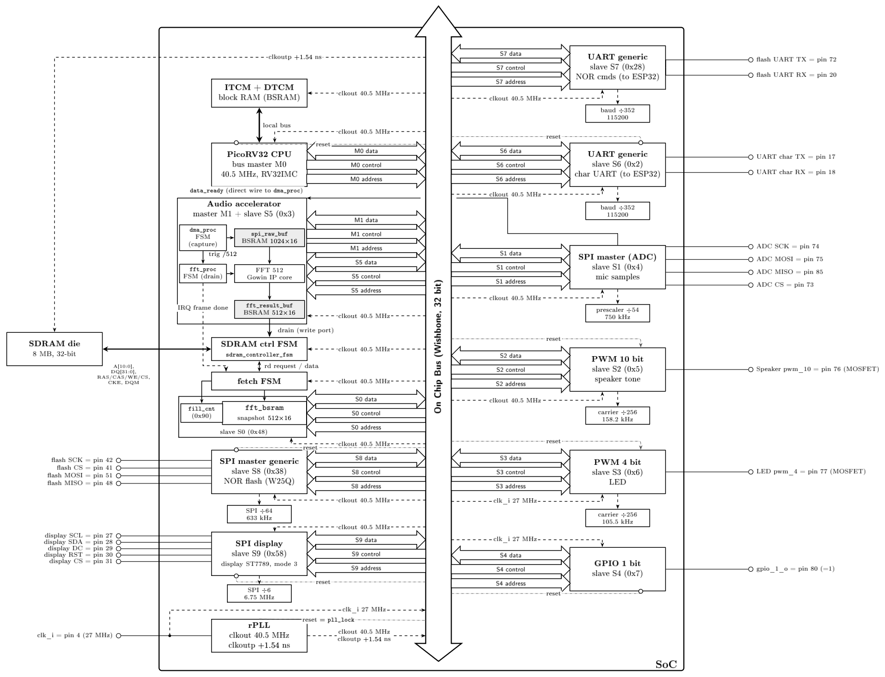

  <p align="center"><h1>🌿 Code built by hand, the old-fashioned way.</h1>
</p>
<p align="center">
  
</p>

<h1 align="center">Gioele Giunta</h1>

<p align="center">
  <b>Computer Engineering · Embedded Systems</b><br/>
  M.Sc. in Embedded and Smart System Design · Politecnico di Torino<br/>
  Hobbyist Data Scientist
</p>

<p align="center">
  <a href="https://www.linkedin.com/in/gioele-giunta-58314b203"></a>
  <a href="https://gioelegiunta.it/"></a>
  
</p>

---

## Featured Projects

### [exposingepstein.com](https://exposingepstein.com) · Epstein Investigation Archive *(proprietary, not on GitHub)*

A platform I built from scratch to make the DOJ Epstein files actually navigable. No company, no budget, no team. Just me and [AquaBomber](https://www.reddit.com/user/AquaBomber), who handled the community while I architected the end-to-end data mining pipelines, implemented a Thompson Sampling reinforcement learning agent to dynamically optimize content ranking and navigation fluidity, and engineered a distributed NLP classification system—leveraging MinHash for near-duplicate detection, spaCy for Named Entity Recognition (NER), and fine-tuned RoBERTa models-to ingest, cluster, and index over 1.39 million heterogeneous files.

The platform now serves 100k+ daily users and holds:

- Over 307,000 photos from the DOJ seizure
- Over 2,000 videos, many with transcriptions and audio analysis
- 1,399,086 of court documents, emails, and flight records, tagged and cross-referenced
- Full-text search across hundreds of thousands of PDFs
- User accounts, community posts, comments, voting, and collaborative investigations

The codebase is proprietary. The database is open and downloadable.

---

# Tang-Nano-20K-AUSP-SoC · GowinPicoSoC FPGA System

A custom 32-bit RISC-V System-on-Chip (SoC) implemented on the Gowin Tang Nano 20K FPGA. Designed as the hardware backbone for the Acoustic Underground Sensor Protocol (AUSP), it features a PicoRV32 core, a custom Wishbone interconnect, and a high-speed SDRAM controller with DMA-driven SPI-to-SDRAM+FFT pipelines.

- **RISC-V Core**: PicoRV32 (RV32IMC) with 64KB ITCM (Instruction) and 64KB DTCM (Data) tightly coupled memory.
- **Custom Wishbone Fabric**: 2-Master (CPU, DMA) / 8-Slave interconnect with dynamic address decoding.
- **Hardware Acceleration**: Dedicated DMA engine performing continuous SPI (MCP3201 ADC @ ~46.9 kHz) to SDRAM transfers, triggering autonomous 512-point FFT computations with IRQ signaling.
- **High-Performance Memory Subsystem**: 108 MHz SDRAM controller (GW2AR-18 rPLL) with a custom memory arbiter prioritizing DMA (M1) over CPU (M0) for zero-stall real-time data streaming.
- **Parametric Peripherals**: 15-bit PWM (audio tone generation), 4-bit PWM (LED dimming), configurable full-duplex UART, and 1-bit GPIO.
- **Validated Stack**: Fully integrated C firmware (built with `riscv64-unknown-elf-gcc`), baked into the Gowin bitstream at compile time, and verified via UART debug at 115200 baud.

  


```text
G. Giunta,
"GowinPicoSoC: A RISC-V Based FPGA System with DMA-Accelerated FFT for Acoustic Sensor Networks,"
Open Source Hardware Repository, 2026.
```

---

### [AUSP-Protocol](https://github.com/G103L3/AUSP-Protocol) · Acoustic Underground Sensor Protocol

A layered acoustic communication protocol for master-slave sensor networks in underground environments (tunnels, mines, pipelines).  
Paper submitted to **IEEE Internet of Things Journal** (under review, Sept 2026).

- 4-layer stack: Physical / Bit / Link / Application
- FFT-based tone detection at 48 kHz with parabolic peak interpolation
- Run-length encoding achieving up to 30 bps over acoustic channel
- Token-based MAC without clock synchronization
- Validated on ESP32 hardware at 14.4 bit/s average, less than 1% retransmission rate

```
G. Giunta, S. Monteleone, D. Patti,
"Acoustic Communication Protocol for Master-Slave Networks in Underground Environments,"
IEEE Internet of Things Journal, under review, 2026.
```

---

## About Me

I work at the intersection of embedded systems and software engineering. My background spans low-level firmware, protocol design, and full stack web and mobile development.

**Embedded Systems**
- Platforms: ESP32, STM32, Arduino Due, Tang Nano
- Focus on real-time signal processing, acoustic communication, and IoT

---
